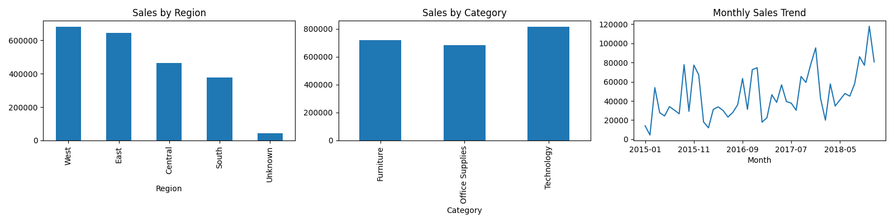

# Data Cleaning & Reporting Automation

## Objective
Automate data cleaning and report generation so one run turns messy sales data into a clean dataset and a visual report.

## Dataset
Superstore Sales data (9,800 rows). A messy copy (`messy_sales.csv`) was created with missing values, duplicate rows and inconsistent text to demonstrate the cleaning.

## Tools
Python, pandas, numpy, matplotlib, openpyxl, Google Colab

## Problems Handled
- Duplicate rows removed
- Missing values filled (Sales by sub-category median, Region as "Unknown")
- Inconsistent text standardized (trimmed spaces, consistent capitalization)
- Dates converted to proper date format

## Method
1. `clean_data()` function performs all cleaning steps and returns a log
2. `make_report()` function builds an Excel report and charts
3. A one-click pipeline runs both functions

## Results
- Rows at start: [9900]
- Duplicates removed: [100]
- Missing values before: [501]
- Missing values after: [0]
- Rows at end: [9800]

## Files
- Data_Cleaning_Automation.ipynb: full notebook
- messy_sales.csv: input with data problems
- Sales_Report.xlsx: automatically generated report
- report_charts.png: automatically generated charts
